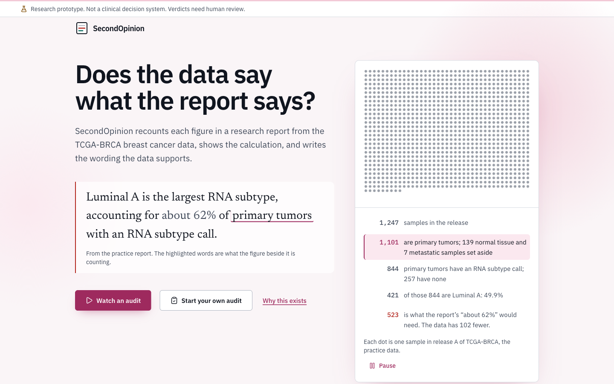
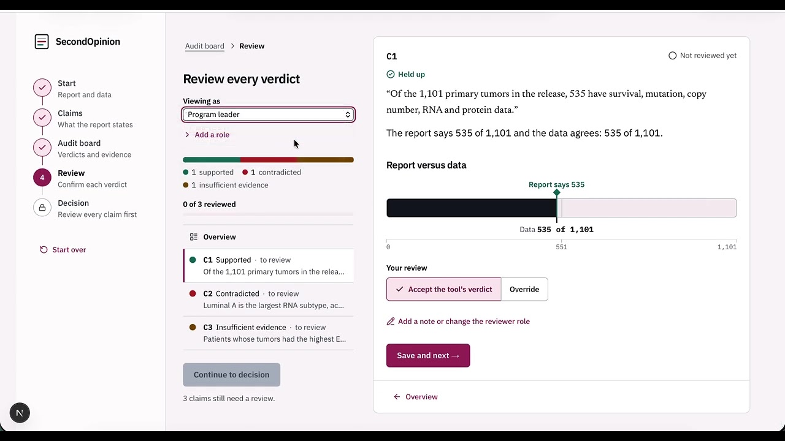
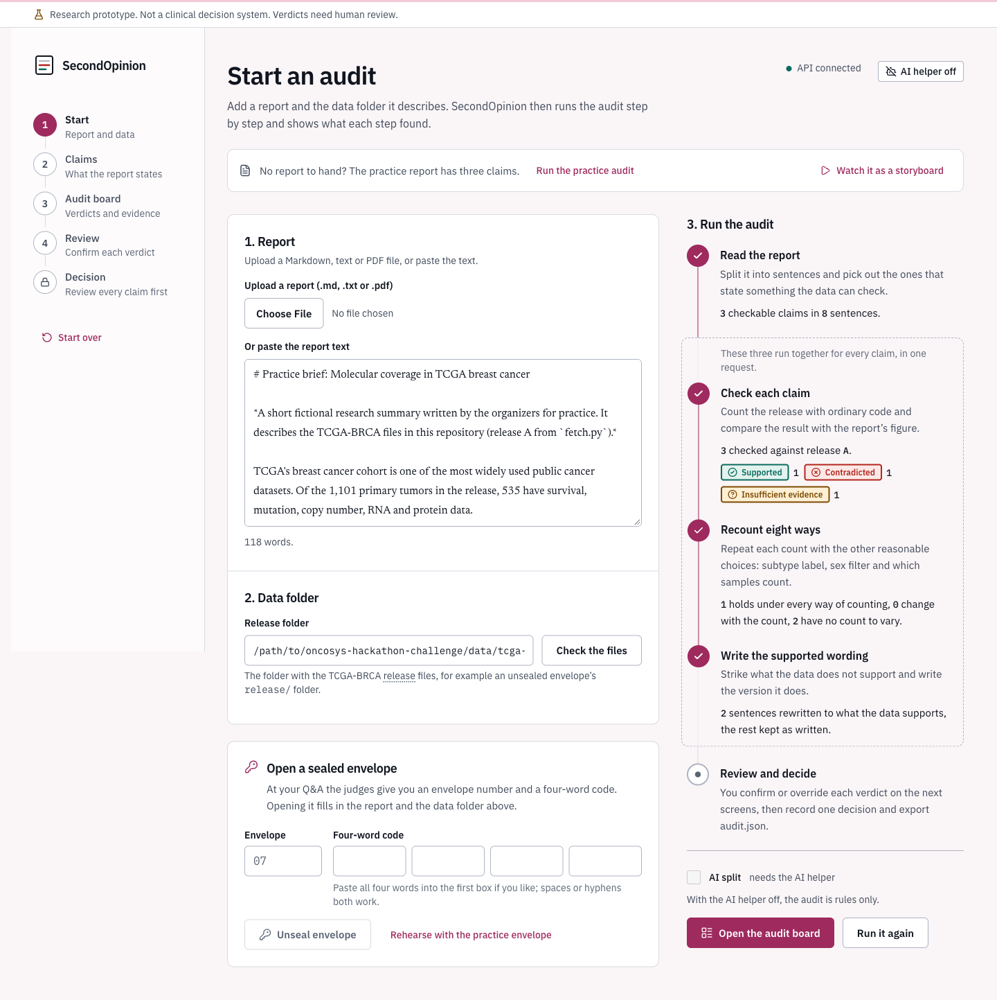
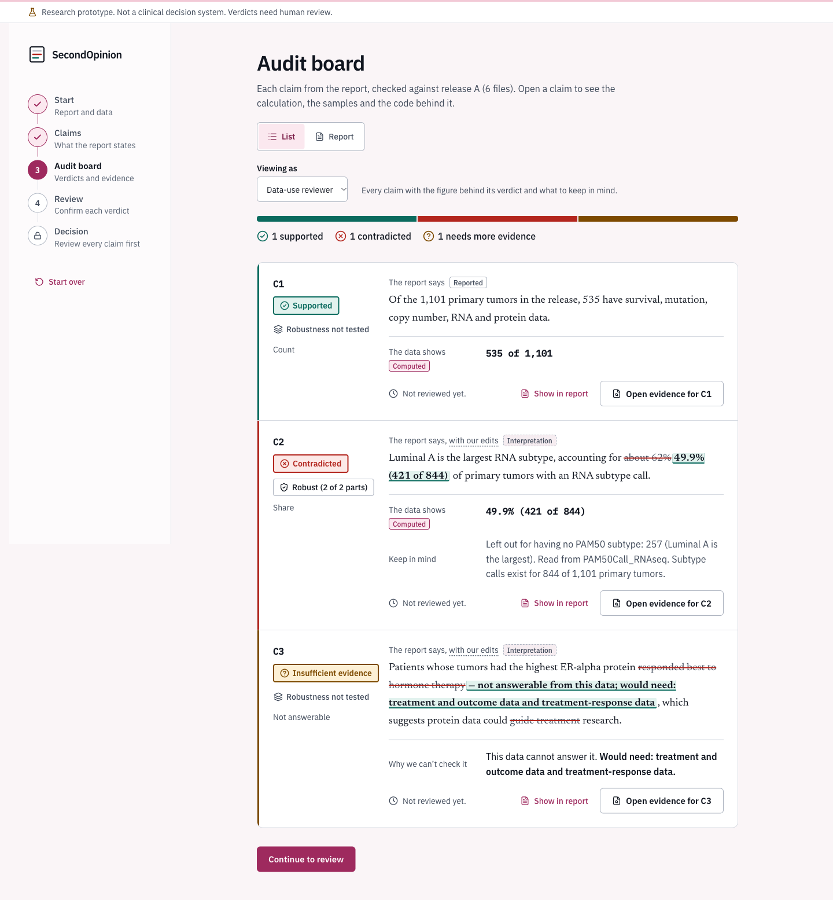
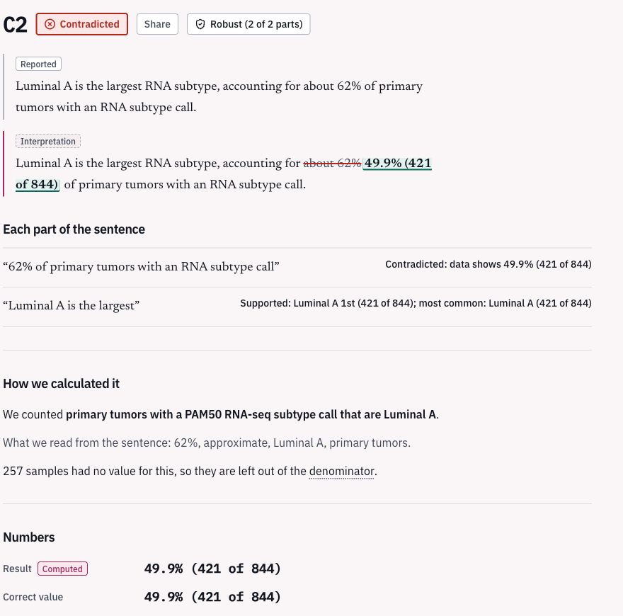
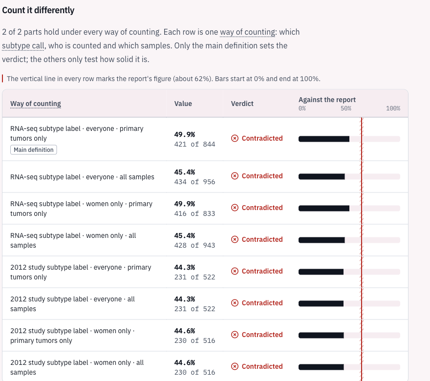

<div align="center">

# SecondOpinion

**Does the data say what the report says?**

A research claim auditor. It reads a report, recomputes every figure from the underlying data with ordinary code, and writes the wording the data supports.


[Demo video](https://youtu.be/JQrZGETIs98) · [Quick start](#quick-start) · [Docs](#documentation)

</div>



🏆 **1st place, Track 2: Evidence Navigator** at the AI Healthcare Hackathon, hosted by The Open Accelerator and OncoSys AI with Northeastern University, Boston. Built by team TechMinds.

> **Research prototype. Not a clinical decision system.** Verdicts need human review.
> No diagnosis, treatment advice or risk scores.

## Contents

- [Demo](#demo)
- [What it does](#what-it-does)
- [See it work](#see-it-work)
- [How a verdict is decided](#how-a-verdict-is-decided)
- [Quick start](#quick-start)
- [Documentation](#documentation)
- [Limitations](#limitations)
- [Team](#team)
- [Data credits and third-party code](#data-credits-and-third-party-code)

## Demo

[](https://youtu.be/JQrZGETIs98)

*Click the picture to watch the demo on YouTube.*

## What it does

Reports about data often say things the data can't fully back up: a percentage that is slightly wrong, a claim about treatment when the data has no treatment records, or a result that only holds if you count one particular way. A reviewer asked "can we trust this report?" would have to dig through files and code to find out. SecondOpinion does that work.

Give it a report and the data release the report is about:

1. **Read.** It pulls out every sentence that makes a checkable factual claim.
2. **Check.** It checks each claim against the real data with ordinary pandas code, never an AI guess, and gives one of three verdicts: `supported`, `contradicted` or `insufficient_evidence`.
3. **Stress-test.** It recounts each claim eight reasonable ways. The verdict is *robust* if it never changes and *fragile* if it flips, and the tool names the choice that flips it.
4. **Rewrite.** The Claim Ladder strikes out over-strong wording and writes the supported version beneath it.
5. **Review.** A person accepts or overrides every verdict, then records one decision: Proceed, Fix a problem, Narrow the question or Stop. The tool exports an `audit.json` in the organizers' shared findings format, plus a Decision Record.

**Example**, from the organizers' practice report:

> Luminal A is the largest RNA subtype, accounting for ~~about 62%~~ **49.9% (421 of 844)** of primary tumors with an RNA subtype call.

The report said 62%. The data shows 421 of 844 = 49.9%, and it is never 62% however you count it (44.3% with the 2012 subtype label, 45.4% counting all samples), so the verdict is *contradicted, robust*.

| Practice claim | Verdict | Why |
| --- | --- | --- |
| 535 of 1,101 primary tumors have all the data layers | `supported` | Recounted from the release files: 535 of 1,101 |
| Luminal A is about 62% of primary tumors with an RNA subtype call | `contradicted`, robust (8 of 8) | 49.9% (421 of 844) |
| Patients with the highest ER-alpha protein responded best to hormone therapy | `insufficient_evidence` | The data has no treatment or response records. It would need treatment and treatment-response data |

**Who it is for.** A reviewer handed a report and asked, "Can we trust this?" Their workflow: load the report and a release folder, keep the sentences that are claims, read the Claim Ladder for each claim, accept or override every verdict, choose one decision, and download `audit.json` and the Decision Record.

> **Scope.** The audit loop (extract claims, recompute from data, stress-test, rewrite, human review) is not specific to one field. The claim checks shipped today read the TCGA-BRCA release's columns, so it was built and tested on breast cancer data. Auditing a different dataset means adding checks for it. See [Limitations](#limitations).

## See it work

**1. Run the practice audit.** One click reads the practice report, finds three claims and audits them. Each step fills in with what it found.



**2. Read the audit board.** One entry per claim: the verdict, how solid it is, and the Claim Ladder rewrite.



**3. Open the evidence.** Every verdict shows how it was calculated, the file checksums, the pandas code that reproduces the number, and the sample IDs.



**4. Count it eight ways.** The same claim recounted with other reasonable choices. The red line is the report's figure.



## How a verdict is decided

All verdicts come from code. There is no AI in the verdict path and no API key anywhere. The optional AI helper can split sentences, propose a check plan and reword the Review page, but the numbers and verdicts still come from code.

- **Numbers:** a stated number is `supported` if it equals the computed value after rounding to the report's own precision. "About", "roughly" and "nearly" allow 2 percentage points (shares) or 2% of the count (counts). Ranges must contain the value.
- **Wording:** "a third", "half", "most", "nearly all", rankings and ratios are turned into numbers and checked the same way.
- **Several checks in one sentence:** checked part by part. The sentence takes the verdict of its worst part, and every part is listed.
- **Can't be checked:** claims about treatment, response, cause or prediction, or about measures the release does not hold, are `insufficient_evidence`, with the data that would be needed.
- **Reference definitions:** the primary number always follows the organizers' definitions. The other ways of counting only decide the robust or fragile tag. They never change the verdict.
- **Close calls** are flagged for the reviewer.

Full rules and the list of claim types: [How a verdict is decided](docs/HOW_VERDICTS_WORK.md).

## Quick start

Needs **Node.js 22+**, **Python 3.11 to 3.14** and **git**. From the repository root:

```bash
python3 -m venv .venv && .venv/bin/python -m pip install -r requirements.txt
npm ci
git clone https://github.com/disleveK/oncosys-hackathon-challenge.git ../oncosys-hackathon-challenge
.venv/bin/python ../oncosys-hackathon-challenge/data/tcga-brca/fetch.py   # about 70 MB, checksums verified
npm run dev
```

Open <http://localhost:3000>, click **Start an audit**, then **Run the practice audit**.

<details>
<summary>Windows (PowerShell)</summary>

```powershell
py -3.13 -m venv .venv; .venv\Scripts\python.exe -m pip install -r requirements.txt
npm ci
git clone https://github.com/disleveK/oncosys-hackathon-challenge.git ..\oncosys-hackathon-challenge
.venv\Scripts\python.exe ..\oncosys-hackathon-challenge\data\tcga-brca\fetch.py
npm run dev
```

</details>

No TCGA data is committed to this repository. If `fetch.py` prints `CHANGED` for a file, do not use that file and tell the organizers. Stuck? See [Troubleshooting](docs/DEVELOPMENT.md#troubleshooting).

**Without the browser:**

```bash
.venv/bin/second-opinion --release ../oncosys-hackathon-challenge/data/tcga-brca/raw \
  --report path/to/report.md --out audit.json
```

It prints one line per claim and writes `audit.json`. It takes `.md`, `.txt` or `.pdf` reports.

## Documentation

| Page | What is in it |
| --- | --- |
| [Getting started](docs/GETTING_STARTED.md) | Ten numbered steps for macOS, Linux and Windows, with every command |
| [User guide](docs/USER_GUIDE.md) | Auditing your own report, the review and decision screens, role views, sealed envelopes |
| [How a verdict is decided](docs/HOW_VERDICTS_WORK.md) | The tolerance rules and every claim type checked |
| [Development](docs/DEVELOPMENT.md) | Configuration, tests, troubleshooting, architecture, API routes |
| [Build plan](docs/PLAN.md), [index of all docs](docs/README.md) | Plan, challenge snapshot, stack references |

## Limitations

These are shown in the product next to the claims they affect, not only here.

<details>
<summary>Show all limitations</summary>

These are shown in the product next to the claims they affect, not only here.

- **Subtype calls are incomplete:** only 844 of 1,101 primary tumors have an RNA-seq subtype call
  (522 have the 2012 study label). Shares are computed over samples with a call; the rest are
  reported as unknown, never dropped silently.
- **No treatment or response data:** claims about treatment, response, cause or prediction get
  `insufficient_evidence` with the data that would be needed. The tool does not guess.
- **Envelope releases have no RNA file and no manifest:** claims about RNA are `insufficient_evidence`,
  and "all five data layers" is counted over the four layers present, with a note saying so.
- **Sex and sample type:** 13 male samples (12 of them primary tumors), 4 primary tumors with no
  recorded sex, and 139 normal-tissue and 7 metastasis samples are mixed in. "Women only" excludes
  unknown-sex rows and reports how many.
- **Claim types covered:** see "How a verdict is decided". Any other kind of claim gets
  `insufficient_evidence` ("No check exists yet for this kind of claim") for a person to check, and the
  optional AI helper may propose a check for it. A check that fails on an unusual release never stops
  the audit: that claim alone becomes `insufficient_evidence`, marked for checking by hand.
- **Receptor status depends on the column:** HER2-positive is 22.5% (164 of 728) by the clinical IHC
  status the tool uses, but 14.9% (114 of 766) by the 2012 study's final status. Claims like this are
  marked fragile with low confidence so a reviewer looks at them.
- **Slide counts need the slide manifest**, which sits next to release A; envelope releases have none.
- **Denominators are the samples with a recorded value.** "64% of patients are postmenopausal" is
  checked as 705 of 973 with a recorded menopause status (72.5%), not 705 of all 1,101. Triple-negative
  is counted among tumours with all three receptor results recorded (116 of 722).
- **Lymph-node status is not checked:** the release has node counts but no single agreed
  "node-positive" field, so such claims get `insufficient_evidence` for a person to judge.
- **Blind-tested:** two independent agents wrote 7 reports (87 claims) with pandas answer keys before
  seeing the tool; all 7 are now in `tests/reports` (reports 6–12) and run with the test suite.
- **The suggested decision is advice.** Every verdict needs a human review before export, and the
  Decision Record names who must sign off.

</details>

## Team

Team TechMinds.

| Name | Built |
| --- | --- |
| Allen | Audit engine: contracts, release loader, checks, verdict rules, the eight recounts, `/audit`, CLI and integration. The optional AI helper, the coverage gate that says "can't check" for half-read sentences, the blind-set scorer, role-aware Review views with AI narration, and the landing page |
| Benoy | Reading the report: sentence splitting, claim typing and number parsing, "data can't answer" detection, skeptic tests, Claim Ladder rewriting, PDF reports, test reports with known answers, the report view that marks each claim (before and after the decision), the AI split switch, Windows support |
| Akshayaa | Web app: app shell and API client, start screen, claims list, audit board with the Claim Ladder, evidence panel, saved state, opening a sealed envelope from the Start page, the visual system, accessibility pass, the storyboard demo (`/demo`), step-by-step setup instructions |
| Meghana | Decisions and outputs: decision rules, `audit.json` export and Decision Record, roles with the add-a-role form, review queue and its gate, decision screen, the practice-data run, the AI sentence split and the join for multi-part sentences, README and third-party list |
| Bhavishya | Research and testing |

## Data credits and third-party code

The results shown here are in whole or part based upon data generated by the TCGA Research Network:
https://www.cancer.gov/tcga. Data via [UCSC Xena](https://xenabrowser.net/) (Goldman et al., *Nat
Biotechnol* 2020) and the TCGA Pan-Cancer Clinical Data Resource (Liu et al., *Cell* 2018); slide
metadata via NCI Imaging Data Commons. Details in
[docs/challenge/DATA_LICENSES.md](docs/challenge/DATA_LICENSES.md).

Libraries and their licenses: [THIRD_PARTY.md](THIRD_PARTY.md). The web fonts are IBM Plex Sans,
IBM Plex Mono and Newsreader (SIL Open Font License).
